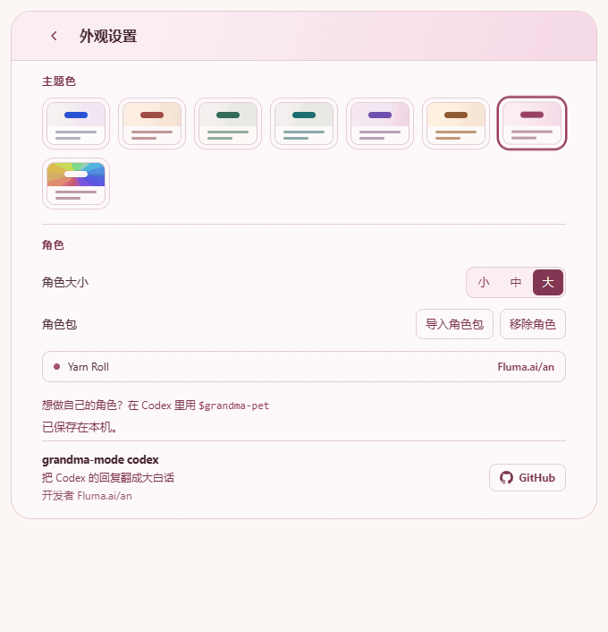

# Grandma Mode for Codex

**Less jargon, more yarn.** · [简体中文](README.zh-CN.md)

Grandma Mode adds a card to Codex Desktop that explains replies in everyday words. Start with the latest completed reply, pick an older one, select a passage, or paste a report.



## Install

You need Codex Desktop with local plugins and chat-sidebar apps, Git for a GitHub install, and Node.js **22.16 or newer**. Keep `node` and the Codex CLI (`codex`) on the PATH used by the desktop app. To generate with your Codex account, sign in with `codex login` and verify with `codex login status`. The default Codex model is GPT-6 Luna.

### From GitHub

Run these commands in a terminal.

```sh
codex plugin marketplace add Fluma-Intelligence/Grandma-mode-for-Codex --ref main
codex plugin add plain-speech@grandma-mode
```

### From an extracted ZIP or local clone

In a terminal, change to the folder containing `.agents/plugins/marketplace.json` and run:

```sh
codex plugin marketplace add .
codex plugin add plain-speech@grandma-mode
```

Open a Codex Desktop chat. In the chat sidebar, click **+ → Grandma Mode**. If the entry is missing, reopen Codex Desktop so it refreshes its local marketplaces. On Windows, if Git reports a long path error, extract or clone to a shorter path and use the local install.

For a GitHub-backed update, run `codex plugin marketplace upgrade grandma-mode`, then `codex plugin add plain-speech@grandma-mode`.

### Automatic updates on Windows

From a checkout of this repository, run this in PowerShell to register a Windows task for the GitHub install. It checks at sign-in and every six hours through Codex's marketplace updater. If Codex is holding the old files open, a later check can apply the update. Reopen the card to load the new files.

```powershell
powershell -NoProfile -ExecutionPolicy Bypass -File .\scripts\grandma-auto-update.ps1
```

To stop the checks, run the same command with `-Disable`.

## Use it

| Tab | What you can do |
| --- | --- |
| **In a few words** | Click **Rewrite latest reply** or **Choose another reply**. The eye opens the original. Highlight a passage and click **Rewrite selection**, or paste your own report. |
| **Show me a diagram** | Click **Make a diagram**. Codex picks a simple format such as a before-and-after card, a timeline, or a bar chart. |
| **Ask little Codex** | Ask for a simpler version of the first answer, next steps, more detail, or a direct answer about whether the work is done. |

The tabs share the selected reply or passage. The original starts folded. Opening the card, looking at history, and switching tabs do not use model allowance. Click an action to generate something. Cached results can reappear without another request. **Rephrase** makes a fresh request for the same text.

The answer follows the original language and keeps material numbers, dates, scope, and uncertainty. The interface follows the system language and supports English, Simplified Chinese, Traditional Chinese, and Japanese.

To have the text tab rewrite new completed replies, check **Auto-rewrite new replies**. It starts off in every card and leaves existing replies alone. It pauses while you work in other tabs, browse replies, or edit the original. Closing the card turns it off. New rewrites use the selected model and its quota.

## Choose a model

Open the gear and use **Rewrite model**. By default, Grandma Mode uses your local Codex subscription and GPT-6 Luna. You can choose another model from your signed-in CLI.

Choose **Custom API** to reveal the API settings. Select an API format, enter the base URL and key, then click **Load models**. Pick a model from the returned list and click **Save**. Use **OpenAI-compatible API** for services such as DeepSeek, OpenRouter, and local servers that support Chat Completions. Remote URLs use HTTPS. HTTP is also supported on localhost, where a key is optional. Saved keys are tied to the URL and API format. **Remove key** deletes the saved key from this device.

## Themes and characters

The gear opens theme and character settings. Choose a preset or a custom color, then pick a character size. There is no default character. To see the three animations, download the [Yarn Roll example pack](docs/examples/yarn-roll.grandma-pet.json) and choose **Import pack**. The character slides, draws a chart, or knits depending on the tab. The app respects reduced motion.

The bundled `plain-speech` skill describes how to use the card. Use the bundled `grandma-pet` skill to make a compatible pack for your own character.

## Data and usage

The local MCP server reads completed replies from the chat you open or explicitly link. A generation click sends the selected text to the provider you saved. Follow-ups may include the first short answer, and **Rephrase** may include the previous answer. Codex uses your Codex allowance. API providers use your own key and may bill that account. Grandma Mode makes direct calls to the selected provider and has no separate backend or telemetry endpoint.

Grandma Mode stores local settings and up to 256 cached results in `$CODEX_HOME/grandma-mode/`. The default path is `~/.codex/grandma-mode/` (`%USERPROFILE%/.codex/grandma-mode/` on Windows). API keys are saved in local settings files, and cached rewrites are stored in SQLite. These files are unencrypted. After closing the app, removing the plugin data folder clears its settings, keys, and results. Codex chat history is managed by Codex.

## Test locally

```sh
node --test
```

The tests use synthetic text and run without an account or model requests. The GIF shows the shipped interface with a fictional report and recorded fixture responses. Open `plugins/plain-speech/ui/index.html` directly for the offline text example.

Developed by **Fluma.ai/an**. Grandma Mode is an independent plugin for Codex. [MIT License](LICENSE) · [Asset notices](NOTICE.md)
