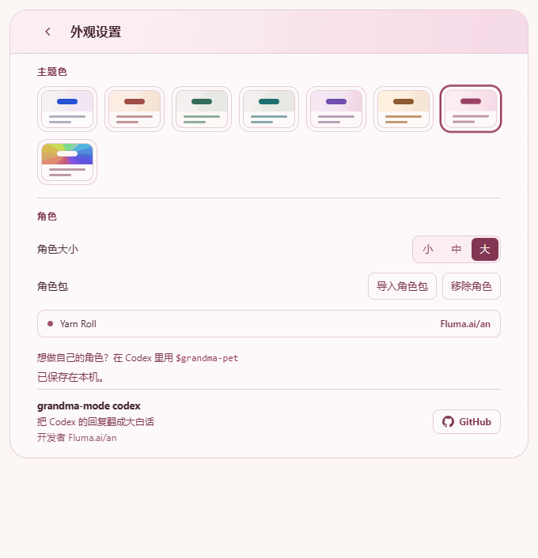

# Grandma Mode for Codex

**少点黑话，多织两针。** · [English](README.md)

在 Codex Desktop 聊天旁边加一张大白话卡片。能翻最新写完的回复、以前的回复、你选中的一段，或者自己粘贴的报告。



## 安装

需要支持本地插件和聊天侧栏应用的 Codex Desktop、Node.js **22.16 或更新版本**，从 GitHub 安装还需要 Git。桌面应用得能通过 PATH 找到 `node` 和 `codex`。使用 Codex 账号生成内容时，运行 `codex login` 登录，再用 `codex login status` 检查。Codex 默认使用 GPT-6 Luna。

### 从 GitHub 安装

在终端运行下面两条命令。

```sh
codex plugin marketplace add Fluma-Intelligence/Grandma-mode-for-Codex --ref main
codex plugin add plain-speech@grandma-mode
```

### 从本地解压包或克隆目录安装

在终端切换到包含 `.agents/plugins/marketplace.json` 的目录，再运行：

```sh
codex plugin marketplace add .
codex plugin add plain-speech@grandma-mode
```

打开 Codex Desktop 的一条聊天，在聊天侧栏里点「＋ → Grandma Mode」。如果侧栏里看不到入口，重新打开 Codex Desktop 刷新本地 Marketplace。Windows 下如果 Git 提示文件路径太长，可以解压或克隆到较短路径，再从本地安装。

从 GitHub 安装的版本可以先运行 `codex plugin marketplace upgrade grandma-mode`，再运行 `codex plugin add plain-speech@grandma-mode` 更新。

## 怎么用

| 标签 | 你可以做什么 |
| --- | --- |
| **一句话说清** | 点「翻最新回复」或「选其他回复」。眼睛可以展开原文，选中一段点「翻这段」，也可以粘贴自己的报告。 |
| **看图解** | 点「生成图解」。Codex 会选合适的样式，例如前后对照卡、时间线或条形图。 |
| **问小 Codex** | 请它把第一版再说白一点，问接下来该做什么，要更多细节，或者直接问到底修好了没有。 |

三个标签共用同一条回复或选段。原文默认折叠。打开卡片、查看回复历史和切换标签都不会消耗模型用量，点生成才会开始。缓存已有结果时可以直接显示。「换种说法」会为同一段原文发起一次新请求。

大白话跟随原文语言，保留重要数字、日期、适用范围和不确定性。界面跟随系统语言，支持简体中文、繁体中文、英语和日语。

## 选择模型

点齿轮打开「翻译模型」。默认使用本机 Codex 订阅和 GPT-6 Luna，也可以从已登录的 CLI 列表里换模型。

选择「自定义 API」后会展开接口设置。选接口类型，填接口地址和 Key，点「读取模型」，从返回列表里选模型再保存。DeepSeek、OpenRouter 和支持 Chat Completions 的本地服务可选「OpenAI 兼容 API」。远程接口使用 HTTPS，本机接口可以用 HTTP，Key 可留空。保存的 Key 只会用于对应的接口地址和类型，可在设置中移除。

## 主题和角色

点齿轮可以选预设主题、自定义颜色和角色大小。默认不加载角色。想看三段动画，可以下载[毛线团示例角色包](docs/examples/yarn-roll.grandma-pet.json)，再点「导入角色包」。切换标签时，角色会滑跪、画图或织毛衣。动画遵循系统的减少动态效果设置。

插件内含 `plain-speech` 使用指南，也可以用 `grandma-pet` 技能给自己的角色做导入包。

## 数据和用量

本地 MCP 服务读取你打开或明确链接的聊天里已写完的回复。点生成后，插件才把选中的文字交给你保存的供应商。追问时可能同时用第一版大白话，「换种说法」会用上一版。用 Codex 账号时消耗 Codex 用量。用 API 时会使用你的 Key，费用由该供应商计入你的账号。插件直接联系所选供应商，没有单独的后端或遥测端点。

本机设置和最多 256 份结果缓存在 `$CODEX_HOME/grandma-mode/`，默认是 `~/.codex/grandma-mode/`，Windows 默认是 `%USERPROFILE%/.codex/grandma-mode/`。API Key 保存在本机设置文件里，改写结果存在 SQLite 里，这些文件没有加密。关闭应用后可以删除插件数据目录来清除设置、Key 和结果。聊天历史由 Codex 管理。

## 本地测试

```sh
node --test
```

测试使用虚构文本，无需登录或调用模型。演示 GIF 录的是实际页面，使用虚构报告和预设的演示回应。直接打开 `plugins/plain-speech/ui/index.html` 可以看离线文字示例。

开发者 **Fluma.ai/an**。Grandma Mode 是供 Codex 使用的独立插件。[MIT 许可证](LICENSE) · [素材说明](NOTICE.md)
